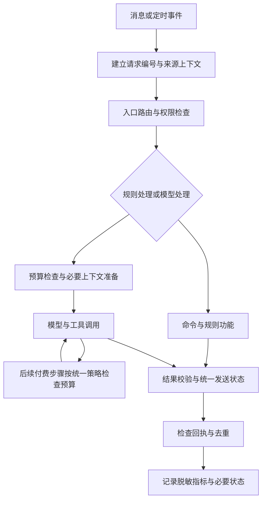

# 大肥鱼机器人插件全面优化方案

版本：v1.0 · 2026-10-29

状态：待评审，尚未开展本方案的全量审查与优化实施
适用范围：当前 AstrBot、全部已安装插件及其直接依赖服务

## 1. 目标与执行边界

将已完成的日志审查与全面插件体验优化合并为一个工作方案，解决功能冲突、输出偏差、上下文断层、重复调用和资源争用，并提供可重复执行的验证方法。

本次只交付方案文档，不修改线上代码、配置或数据库，不重载插件、不重启服务、不发送群消息、不调用付费模型。后续按“只读审查 → 具体改动方案 → 分批实施 → 验收”推进。需要真实QQ收发、付费请求、权限操作或服务重启的测试，先列明测试内容、影响与预期结果，再安排执行。

优先复用框架现有能力，不预先决定新增统一管理插件或大范围重构。保留现有人格、记忆、插件数据与用户文件；禁用状态不能因审查而被改变。各阶段分别标明完成、未验证、阻塞，不把静态检查通过当作线上功能验收。

## 2. 已有证据与使用限制

来源：[日志审查与优化建议](机器人日志审查与优化建议-2026-10-29.md)；原始统计快照保留在本机 `review/log-audit-20261029/statistics.txt`，不随源码备份上传。以下是10月29日约16:15前后的历史快照，实施前须重新确认现状。

| 北京日期 | 框架运行记录 | error记录 | 输入缓存命中率 | 运行耗时中位数 | P90 |
|---|---:|---:|---:|---:|---:|
| 10月26日 | 143 | 0 | 64.5% | 1.79秒 | 3.07秒 |
| 10月27日 | 154 | 2 | 69.1% | 1.73秒 | 4.46秒 |
| 10月28日 | 187 | 3 | 77.0% | 1.85秒 | 3.12秒 |
| 10月29日，截至检查 | 76 | 0 | 82.8% | 2.14秒 | 6.59秒 |

这些次数是框架运行记录，不是供应商实际请求数；多步调用可能产生多次收费请求。耗时不是从用户发消息到QQ实际收到回复的端到端耗时。缓存率按输入token加权。四天有7条运行耗时超过30秒，不能仅凭统计定位原因。

当前详细Docker日志只覆盖10月29日12:08—16:13，共5942行；不具备过去几天完整消息链路。原始日志含聊天内容，不复制进交付报告或提交版本库；报告只引用必要的脱敏证据。

已发现的问题作为审查入口，不代表已完成所有插件排查：

| 发现 | 已有证据 | 后续方向 |
|---|---|---|
| 用量费用重复换算 | 成本库币种为CNY，usage_view仍乘6.67；日志出现340%—368%费用超限显示 | 优先修币种和统计窗口，不能直接认定预算闸门失效 |
| 主动播报发送失败或跳过 | 22条平台匹配失败、9条缺少缓存msg_id | 区分启动顺序、目标ID、上下文和权限问题，检查真实回执 |
| 上下文输入增长 | 平均历史归因约399→14080 token；额外注入约808→2026 | 限长、去重、相关性筛选，并验证长历史压缩 |
| 工具固定开销增加 | 工具定义平均归因约2570→5656 token | 检查重复工具、定义长度和入口白名单一致性 |
| 无效后台轮询 | B站缺凭据仍反复检查，54条相关警告 | 不使用则停止监听，使用则补齐配置并验证 |
| 启动噪声较多 | 444条pip弃用警告、多次初始化 | 依赖持久化、合并维护变更、检查任务生命周期 |
| 排行榜工具入口不完整 | 新专用工具未进入所查人格白名单；旧query_project_info可查询榜单 | 区分命令、已有工具回退和专用工具的实际可达性 |

当前缓存改善应保留。10月29日检查时可用内存约1.4GB、磁盘剩余14GB、负载低，暂不以升级服务器作为首选。旧watchdog文件最后修改于10月23日，不能作为今天持续阻塞的证据；lol_esports历史加载失败之后已有成功加载记录，须重新验证，不能直接算作当前故障。

## 3. 全量盘点和覆盖标准

以线上实际清单为准，不把旧手册中的插件数量当作当前事实。覆盖启用、禁用和遗留目录；只对启用插件开展完整功能验收，对禁用插件验证无意外任务和入口残留。

每个插件登记：

- 名称、版本、启用状态、线上路径、本地维护源、用途及维护方式。
- 命令与别名、匹配条件、优先级、消息拦截行为、模型工具及其白名单可达性。
- 收发消息、模型请求、知识检索、记忆读写、预算检查的钩子与执行顺序。
- 后台任务、轮询周期、启动/重载/卸载行为、超时和重试策略。
- 数据库、缓存、共享目录、外部接口、模型和凭据依赖（只记录是否配置，不记录密钥）。
- CPU、内存、网络、磁盘和并发需求；资源数据缺失时注明待测。
- 测试方式、已验证程度、已知限制及回滚方式。

盘点覆盖游戏运营、成本与用量、说明书、长期/每日记忆、搜索、音乐、语音/翻唱、媒体解析、表情、主动消息、动态订阅、赛事及管理等实际安装功能。清单完成后才能确定完整测试分母。

## 4. 冲突检测方案

采用“静态清单与调用图 + 当前配置核对 + 脱敏日志证据 + 隔离测试”的组合方式。先检测共享入口和资源，再复核有关插件组合，避免只靠全文关键词或机械两两比较作结论。

| 冲突类别 | 检查重点 | 典型验证场景 |
|---|---|---|
| 功能入口 | 命令/别名重名、正则重叠、FAQ抢答、解析器自动触发 | 同一句话只产生预期处理；复合请求按明确顺序执行 |
| 逻辑和权限 | stop_event、处理标记、预算覆盖、管理权限、降级路径 | 规则回复后不意外进入模型；越权操作被拒绝 |
| 输出口径 | 币种、时区、范围、缓存有效期、任务和发送状态 | 两插件查询同一事实结果一致，失败不显示成功 |
| 上下文 | 人格来源、会话身份、引用、记忆范围、工具结果 | 跨插件追问不丢对象；不同群和用户不混淆 |
| 生命周期 | 重载重复注册、任务未取消、重复定时和重试 | 重载前后任务数量稳定，停止后不继续执行 |
| 资源与依赖 | 同步阻塞、锁竞争、重复轮询、并发下载/音频/模型请求 | 隔离并发测试不阻塞普通消息，不产生无限队列 |

每条问题必须包含：编号、涉及插件/版本、触发条件、证据位置、复现步骤、预期与实际、用户影响、严重程度、修复建议、回归用例及状态。

证据等级分为“已复现”“代码与配置可确认”“日志支持但原因待定”“待测试”。严重程度分为高（错误操作、信息越界、错误计费判断、核心功能失败）、中（重复回复、上下文中断、频繁超时）、低（噪声和可用性细节）。同一故障的多行堆栈不能算成多次事故。

## 5. 功能输出准确性验证

为每项公开命令、模型工具和自动任务建立用例，不只按插件名称写一个“通过”。每项至少包含正常、无数据、无效输入和依赖失败场景；涉及权限、缓存、时间边界和重试的额外测试。

| 功能类别 | 对照来源和预期标准 | 必测边界 |
|---|---|---|
| 状态、人数、房间、榜单 | 同一时间窗口的真实接口；名次积分不改写 | 并列、同名、空榜、部分失败、数据日期、主服/契约服 |
| 用量、成本、预算 | 只读数据库、币种配置、北京时间窗口；官方账单单独对账 | CNY/USD/未知币种、跨日跨月、缺失费用、阈值前后 |
| FAQ、知识库 | 当前维护源和明确游戏规则 | 动态事实不能引用旧知识；无资料明确说明；资料过期 |
| 人物与长期/每日记忆 | 有来源和时间的测试事实 | 同名、改口纠正、跨群、引用他人、检索不到、重复记忆 |
| 音乐、语音、翻唱、解析 | 请求对象、任务记录、实际产物 | 歌名歧义、任务重查、失败/超时/取消、降级、空产物 |
| 表情与普通聊天 | 既定人格与格式要求、允许的行为范围 | 规则命令不多余聊天；语音/表情不重复发送正文 |
| 通知与定时任务 | 持久化任务记录、目标与平台回执 | 重复触发、重启恢复、权限不足、无msg_id、部分送达 |
| 管理功能 | 权限矩阵和隔离环境状态 | 非管理员、群/私聊差异、目标错误、重复执行；不在真实群试踢人 |

正确性断言尽量使用结构化数据。模型生成文本按事实、来源、权限、格式和连续性评分，不要求逐字一致。源数据变化时记录采样时间；无法取得权威对照时标记未验证，不宣称“无偏差”。

## 6. 信息流转与调用链路优化设计

先绘制当前链路，再按实际冲突决定改动。目标链路如下，不代表目前已经实现：

统一上下文优先使用框架已有事件字段和扩展字段，建议包含请求编号、来源会话、用户、触发方式、原始意图、已完成操作、数据来源与时间、预算结果、任务编号和发送状态。只传递必要信息，避免增加全量聊天副本和新的长期存储。

设计约束：

1. 一条消息确定主要处理入口；复合请求允许组合，但明确先后和结束条件，避免各插件独立抢答。
2. 同轮、同权限范围内的相同读取可复用；跨轮缓存必须有范围、有效期、失败策略和来源时间，不能混用用户私有数据。
3. 长任务复用任务编号，追问“完成了吗”不重新创建任务；并发相同请求可合并。
4. 外部网页、引用、聊天记录和工具返回只作为数据；不允许其中的内容提升权限或变成控制指令。
5. 区分普通回答上下文与记忆写入来源；按既定共享策略使用记忆，禁止无意泄露私聊。是否调整共享范围另列决策，不能擅自切换。
6. 预算、超时、重试和发送回执保持一致语义；单次失败不得进入无限工具循环或重试。
7. 稳定人格和工具前缀，控制记忆总长度；上下文优化不能靠每轮任意改工具集或重新裁剪全部历史实现。

重点链路用例：查询榜单后追问某昵称；查询在线后切换契约服；搜歌后选择并查询任务；提交Bug后查看进度；修改人物事实后追问；预算拒绝后使用不收费的规则查询。每项分别测试命令入口、@聊天入口和有关自动任务入口。

## 7. 分阶段执行与交付

### 阶段A：只读审查和基线

核对线上插件、配置、任务和版本；完成冲突清单、覆盖矩阵与当前链路图。收集可比基线，区分冷启动、普通聊天、工具查询和后台任务。不增加生产压力来补数据，缺失指标先列明。

交付：插件清单、冲突检测报告初版、验证矩阵、具体修复批次。此阶段不承诺已经验证全部实际QQ功能。

### 阶段B：第一批——准确性与送达

优先处理费用币种与窗口、未知费用显示、主动发送回执和去重、入口权限、排行榜工具可达性及报告中其他高优先级问题。改动前确认源码未漂移，备份相关文件和必要数据。每个问题建立修复前失败、修复后通过的用例。

验收后再进入下一批；涉及服务重启、真实消息和管理操作的测试分别安排。

### 阶段C：第二批——上下文与重复调用

落实必要的上下文字段、去重和同轮数据复用；给记忆注入加长度预算和相关性筛选；检查低质量内容召回；统一必要入口的人格和工具策略。长历史压缩单独验证输入长度、事实保留、失败回退和恢复行为，不能与其他改动混在一起归因。

### 阶段D：第三批——后台任务与资源

停止无效轮询，修复任务启动/终止，依赖预装与持久化；为高耗资源任务设置有界并发和队列、取消与超时。先隔离测试再低负载验证，不在共享游戏服务器压测。

### 阶段E：回归与使用方案

回归全部启用插件和受影响组合，观察后台任务至少一个正常执行周期；保留未测项目。更新用户命令指南、管理员排障方法、数据口径和限制，附版本及回滚记录。

所有正式文档放在本目录。后续计划交付：

| 文档 | 必备内容 |
|---|---|
| 插件清单与冲突检测报告 | 线上版本、启用状态、依赖、冲突证据、严重程度、处理结论 |
| 插件功能验证矩阵 | 用例编号、输入、环境、对照来源、预期/实际、结果与证据 |
| 插件优化实施与回滚方案 | 分批改动、依赖、影响、备份、恢复步骤、实施状态 |
| 插件使用方案与验收标准 | 入口、组合操作、例子、错误提示、限制、复现命令与指标 |

本方案引用既有日志报告作为证据，后续报告不能直接把其历史快照当作当前状态。

## 8. 可复现验收标准

| 维度 | 验收规则 |
|---|---|
| 覆盖 | 已安装插件100%盘点；每个启用功能有用例和结论；未执行项明确列出，不计入通过 |
| 准确性 | 可确定输出与源数据或固定夹具一致；时间、币种、范围一致；模型回答不得杜撰关键事实 |
| 权限与隔离 | 无越权执行、无非预期跨用户/跨会话数据泄露；隔离测试的负例全部通过 |
| 去重与连续性 | 固定组合用例没有非预期重复回复、重复任务、重复付费调用；追问能引用正确对象 |
| 送达 | 实际回执与状态一致；失败和部分成功可区分；不支持的主动消息场景明确说明 |
| 生命周期 | 连续3次隔离重载后相关任务/监听数量不增长；终止后无残留写入或发送 |
| 性能 | 同条件同用例记录P50/P90、工具耗时和端到端耗时；规则与模型请求分开，不混用框架耗时 |
| 缓存与成本 | 冷启动与稳定阶段分开；按同入口与请求类型比较加权命中率和每次实际token，不以整体百分比掩盖变化 |
| 资源 | 记录任务前、中、后内存和队列；无持续增长、失控重试、数据库锁错误或新增主线程阻塞 |
| 恢复 | 超时、接口失败、重载和重启后的恢复路径有测试；回滚后关键基线用例通过 |

确定性与隔离用例可重复3次。真实模型正确性每个代表场景建议至少3个样本；性能比较每个可比请求类别建议累计不少于30个样本，不为凑样本额外产生未安排的费用。样本不足只报告观察值。P90回退超过10%或缓存率下降超过5个百分点作为调查触发线，不单独证明失败或成功；若为正确性修复产生合理代价，需单独说明并评审。

复现材料保留：代码版本/文件哈希、脱敏配置差异、北京时间、测试环境、输入夹具、源数据时间、执行方法、实际输出和结果。不得保存凭据；涉及群聊原文的证据仅本地受限留存，不附入公开报告。

## 9. 发布与回滚标准

每批独立备份和验收，避免一次性更换模型、预算、人格、记忆范围和多个插件。采用插件级变更时优先限定影响；确需容器或游戏服务重启时单独说明。数据库变更先评估迁移与恢复方式，不覆盖活跃数据库作为通用回滚手段。

出现错误管理操作、信息越界、错误费用判断扩大、核心命令不可用、重复发送或资源失控时停止该批次，按预先验证的方式回滚并核查残留任务。发布后状态分别记录为“文件已更新”“重载成功”“接口验证通过”“真实消息验证通过”，不混为“全部上线成功”。

建议批准后的第一步是阶段A全量只读审查。完成后依据实际证据形成具体改动清单，再按B—E推进；本文件尚不是全量冲突报告或已完成优化的证明。
